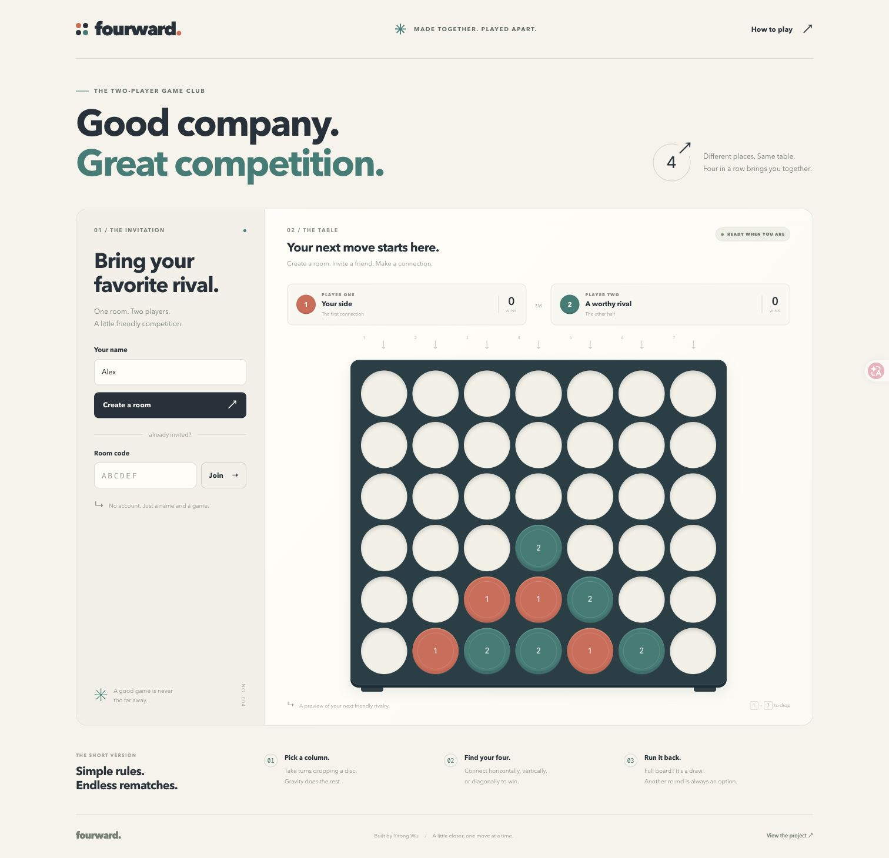
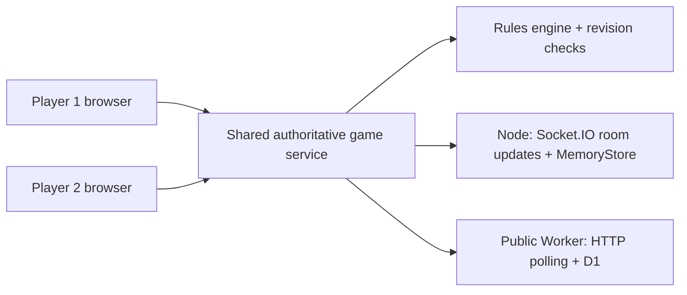

# Fourward

[](https://github.com/aryawuyitong/fourward-multiplayer/actions/workflows/ci.yml)

**A friendly rivalry, from anywhere.** A two-player, server-authoritative four-in-a-row game by **Yitong Wu**.

[Open the public demo](https://fourward-yitong-wu.bradley9900.chatgpt.site) · [Testing & evidence](docs/TESTING.md) · [Project submission](docs/SUBMISSION.md)

**Verified October 29, 2026:** 40 automated tests passed; the public server passed 50 request checks; two independent browser sessions completed a live game. Physical-device acceptance remains to be recorded.



Create a room, share its six-character code or invite link, and take turns with a friend. No account or installation is required. The interface includes numbered discs, keyboard controls, connection status, a winning-line highlight, and a match score that carries into rematches.

## Project requirements

| Requirement | Implementation | Evidence |
| --- | --- | --- |
| At least two players on separate devices | Two authenticated seats in a shared room; both clients read the same server state | Automated independent-client tests; physical-device acceptance checklist remains pending |
| Rules players can follow themselves | In-game rules dialog, visible turns, numbered columns, enforced legal moves | [Rules below](#how-to-play) and [test coverage](docs/TESTING.md) |
| A URL other people can reach | Public Worker deployment with persistent D1 room storage | [Demo](https://fourward-yitong-wu.bradley9900.chatgpt.site); public API and two-browser game verified |

## How to play

1. Enter your name and create a room. Send its code or invite link to a friend.
2. Your friend opens the game on another device, enters their name, and joins that room.
3. Player 1 starts. On your turn, click a column, tap its arrow, or press **1–7**. Your disc falls to the lowest empty space.
4. Connect **four discs horizontally, vertically, or diagonally** to win. A full board without a winner is a draw.
5. Both players must request a rematch. Scores remain, and the starting player alternates.

A full column cannot accept another disc. Play pauses while the other player is offline; their seat remains reserved. Reloading the same browser tab can restore its saved seat. Explicitly leaving closes the room for both players. Rooms expire after approximately 24 hours without activity.

## Run locally

Use **Node.js 22.13 or newer**; **Node.js 24** is recommended, including for the SQLite-backed tests.

```sh
npm --prefix app ci
npm --prefix app run dev
```

Open `http://localhost:3000`. Use two independent tabs or browser sessions to create and join a room. For a second device on the same Wi-Fi, open `http://YOUR_COMPUTER_LAN_IP:3000` and allow local network access if prompted. The public demo works across different networks.

```sh
npm --prefix app test          # Rules, storage, HTTP, and Socket.IO integration
npm --prefix app run check     # Tests, Worker build, and artifact validation
npm --prefix app start         # Start the Node server without watch mode
```

To exercise an already running deployment, create and close a disposable test room:

```sh
node app/scripts/smoke-live.mjs https://fourward-yitong-wu.bradley9900.chatgpt.site
```

## Design and architecture



Both deployments use the same rules, seat authentication, and revision checks. Players submit actions; the server decides whether they are legal and commits the resulting state.

- **Local / optional Node hosting:** HTTP actions and Socket.IO room-scoped state updates. MemoryStore is intentionally simple; restarting the process loses its rooms.
- **Public demo:** Cloudflare Worker and D1, synchronized by HTTP polling every second. This is polling, not WebSockets: it trades about one second of update delay and extra read requests for a deployable, persistent serverless version of a turn-based game.

The optional [`render.yaml`](render.yaml) blueprint deploys the Node variant. It is an alternative hosting path, not a claim that a Render instance is running. See [architecture and deployment details](docs/ARCHITECTURE.md).

## Project structure

```text
app/
  public/       Responsive interface, rules, and browser client
  server/       Shared rules, service, stores, HTTP API, Node server
  worker/       Public Worker adapter
  drizzle/      D1 schema migration
  test/         Automated game, API, storage, and transport tests
  scripts/      Worker build and artifact validation
docs/           Architecture, development record, testing, submission
render.yaml     Optional Node hosting blueprint
.github/        Continuous integration
```

## Evidence and limitations

Read the [development record](docs/DEVELOPMENT.md) for design decisions and the expiry-race correction, and [testing report](docs/TESTING.md) for verified results and remaining acceptance work. Screenshots show the actual interface; a mobile viewport screenshot is not evidence of a physical-phone test.

This is a focused student project: two seats, no spectators or accounts, no distributed abuse prevention, and no guarantee that closing a tab preserves its session. Seat tokens are private; invite links contain only the room code. The Node variant does not persist rooms across server restarts.

**AI assistance:** ChatGPT/Codex assisted with implementation, documentation, debugging, and automated verification. This repository makes that assistance explicit; the development and testing documents distinguish observed results from pending manual checks.

Created for the Handshake **Create a Multiplayer Game** project. [Submission text](docs/SUBMISSION.md) is provided for review and adaptation.
