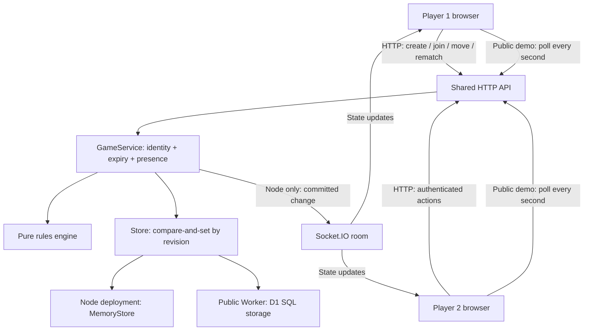

# Architecture

**Fourward · Yitong Wu · October 29, 2026**

Fourward has one authoritative rules engine and two deployment adapters. A browser never submits a replacement board, winner, or score. It submits a requested action and the revision of the board it saw.

## Request and synchronization flow

`/api/config` tells the client which transport is available. In Node, Socket.IO subscribers authenticate their seat and join the corresponding room; updates go only to that room. Actions still use the shared HTTP API. HTTP polling also provides a fallback if the socket is unavailable.

The public Worker uses authenticated HTTP polling at a one-second interval. Each successful action returns its committed state immediately; the other player receives it on a subsequent poll. Network delays can add to that interval. This fits a turn-based game but would be a poor fit for a fast action game.

## Modules

| File | Responsibility |
| --- | --- |
| `app/server/game.js` | Gravity, turns, winning axes, draws, rematches, public state |
| `app/server/service.js` | Room creation, seat authentication, presence, expiry, committed changes |
| `app/server/stores.js` | MemoryStore and D1Store with the same contract |
| `app/server/api.js` | JSON routes, bounded bodies, same-origin checks, errors |
| `app/server/index.js` | Node HTTP server and Socket.IO rooms |
| `app/worker/index.js` | Worker request adapter and D1 binding |
| `app/public/client.js` | Interface, saved tab session, transport selection, recovery |

## State and concurrent requests

A room contains a 6×7 board, two reserved seats, current turn, round, scores, rematch votes, winning cells, last move, and an increasing revision. A separate heartbeat timestamp belongs to each seat.

For a move, the service authenticates the seat, checks expiry and presence, and asks the rules engine to validate the turn, column, and current round. The store commits only if the stored revision still matches the request's expected revision. If two requests race, one can commit; the other receives a conflict and refreshes. Heartbeats update separate fields so they do not invalidate a move's game revision.

The client also refuses an older revision received after a newer response. It renders the server's board; there is no speculative client-side winner calculation.

## Identity and room lifetime

- A six-character room code invites the second seat; it is not a seat credential.
- Each seat receives a cryptographically generated 256-bit secret token. The store retains its SHA-256 hash; public state exposes neither token nor hash.
- The browser keeps its token in `sessionStorage`. Reloading the same tab can resume that seat. Closing the tab, clearing storage, or switching browsers is not a supported recovery method.
- A third player cannot replace an offline player. There is no spectator mode.
- Presence uses a 20-second heartbeat grace. Network detection and browser scheduling can delay visible changes. Moves pause while the opponent is offline; there is no automatic forfeit.
- Rooms expire after approximately 24 hours without activity, including heartbeats. Expired rooms cannot be read or joined. Expired records are collected in bounded batches during room creation.
- A deliberate leave closes the room. A dropped connection reserves the seat and pauses play.

The API restricts cross-origin browser requests and bounds JSON bodies to 2 KiB. These controls complement authentication; they are not a distributed rate limiter. The project has no accounts, moderation, or production-scale abuse controls.

## Hosting

The public deployment uses a Cloudflare Worker with a `DB` D1 binding. The Worker bundle embeds the authored HTML, CSS, and JavaScript. The schema lives in `app/drizzle/`; the Sites publication workflow packages migrations with the artifact and applies them during deployment. D1 persists rooms independently of Worker instances.

Local development runs the Node adapter. The optional root `render.yaml` offers another Node hosting route: `app` is its root directory, `npm ci --omit=dev` its build command, and `npm start` its start command. MemoryStore is process-local: deployments, restarts, or multiple independent instances lose or partition rooms. A durable shared store and cross-instance Socket.IO adapter would be required before scaling that variant.

## Design tradeoffs

| Decision | Benefit | Cost / boundary |
| --- | --- | --- |
| One rules engine for both hosts | Tests cover the same rules used by the public game | Both transports still need integration checks |
| One-second public polling | Simple HTTP deployment and persistent shared state | Repeated requests and update latency |
| Optimistic revision check | Prevents competing state commits | Stale requests must refresh and retry |
| Secret seat tokens | No sign-up required | Lost browser session cannot reclaim a seat |
| Both players approve rematch | Prevents unilateral reset of a finished result | Both participants must agree |
| Alternating starter | Makes repeated rounds fairer | Scores last only for the current room |

## References

- [Socket.IO rooms](https://socket.io/docs/v4/rooms/) — server-side room membership and targeted broadcasting.
- [Cloudflare D1 documentation](https://developers.cloudflare.com/d1/) — the public deployment's SQL storage.
- [Node.js SQLite API](https://nodejs.org/api/sqlite.html) — the local real-SQL adapter used to exercise D1Store.
